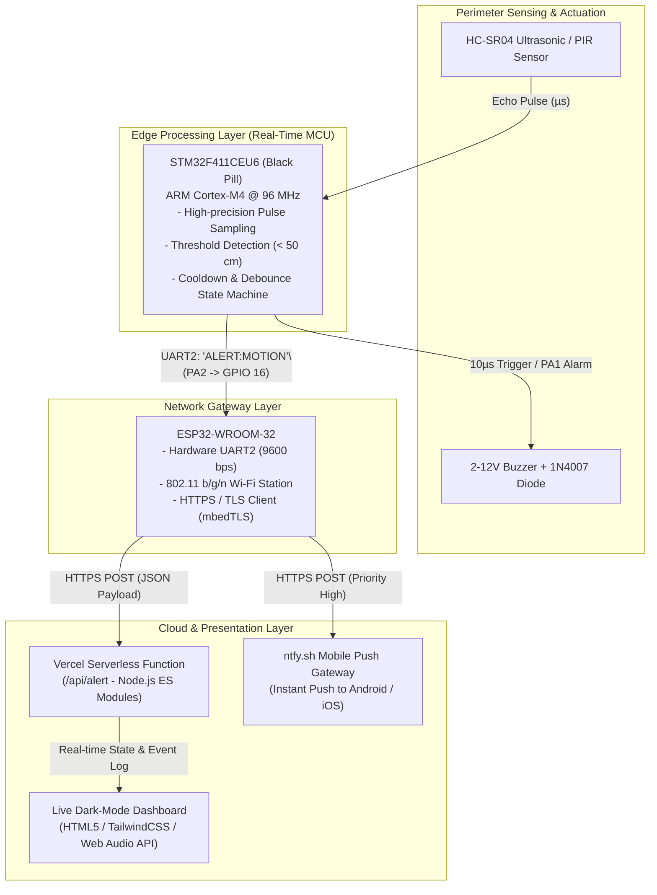
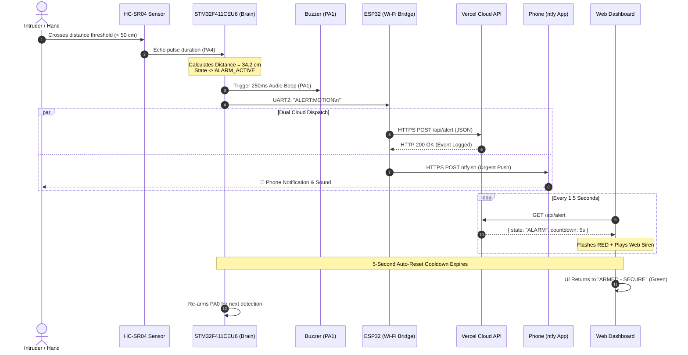

# 🛡️ Engineering Project Report: Smart Home IoT Security & Intruder Detection System

**Author / Project Lead:** Jithendra V Anand  
**Target Platform:** STM32F411CEU6 ("Black Pill") & ESP32-WROOM-32  
**Cloud Infrastructure:** Vercel Serverless Backend & ntfy.sh Push Gateway  
**Repository:** [https://github.com/JithuMon10/Motion-Sensor](https://github.com/JithuMon10/Motion-Sensor)  
**Live Production Dashboard:** [https://motionsensorgasp.vercel.app/](https://motionsensorgasp.vercel.app/)

---

## 1. Executive Summary

The **Smart Home IoT Security System** is a distributed edge-to-cloud security node designed to detect perimeter intrusions with high precision, emit immediate localized audible alerts, and dispatch encrypted real-time security events to a cloud monitoring dashboard and mobile devices.

To comply with academic syllabus standards, an **ARM Cortex-M4 microcontroller (STM32F411CEU6)** acts as the **Primary Real-Time Controller**. It handles real-time sensor sampling, physics calculations (ultrasonic time-of-flight), actuation of warning alarms, and state-machine transitions. An **ESP32** operates as a subordinate **Network Gateway / Wi-Fi Bridge**, offloading high-overhead cryptographic handshakes (TLS 1.2/1.3), TCP/IP stack management, and cloud REST calls.

---

## 2. Complete System Architecture



---

## 3. End-to-End Data Transmission Breakdown

The transmission pipeline is segmented into five distinct protocol layers:

```
[Layer 1: Acoustic ToF] ➔ [Layer 2: GPIO Interrupts] ➔ [Layer 3: Serial UART] ➔ [Layer 4: TLS / HTTPS] ➔ [Layer 5: Serverless State]
```

### Layer 1: Physical Acoustic Sensing (Sensor ➔ STM32)
1. **Pulse Emission:** The STM32 drives pin `PA0` (Trig) `HIGH` for exactly **10 microseconds** using direct cycle-accurate delay timers.
2. **Ultrasonic Burst:** The HC-SR04 sensor transmits an 8-cycle burst of ultrasound at **40 kHz**.
3. **Echo Measurement:** The sensor sets `PA4` (Echo) `HIGH` until the reflected wave returns. The STM32 measures the pulse duration using microsecond timing:
   $$\text{Distance (cm)} = \frac{\text{Duration } (\mu\text{s}) \times 0.0343 \, \text{cm}/\mu\text{s}}{2}$$
4. **Edge Threshold Evaluation:** If measured distance satisfies:
   $$2 \, \text{cm} < \text{Distance} \le 50 \, \text{cm}$$
   the STM32 state machine transitions from `ARMED` to `ALARM_ACTIVE`.

### Layer 2: Real-Time Actuation & Serialization (STM32 Controller)
1. **Audible Alarm Generation:** STM32 pin `PA1` activates the 2–12V buzzer with a discrete 250 ms burst at 2000 Hz. The reverse-biased **1N4007 rectifier diode** absorbs inductive kickback voltage (flyback EMF), protecting the MCU GPIO output transistors.
2. **Visual Feedback:** Pin `PC13` drives the onboard blue LED `LOW` (active-low configuration).
3. **Command Serialization:** The STM32 formats an ASCII message terminated with a newline (`\n`):
   ```text
   ALERT:MOTION\n
   ```
   and transmits it across hardware **USART2** (`PA2` TX ➔ ESP32 `GPIO 16` RX2) at **9600 Baud, 8 Data Bits, No Parity, 1 Stop Bit (8-N-1)**.

### Layer 3: Network Gateway Processing (ESP32)
1. **Interrupt Buffer:** The ESP32 Hardware FIFO captures the incoming serial stream.
2. **Message Parsing:** The buffer is delimited by newline `\n`. If the parsed string matches `"ALERT:MOTION"`, the dual-thread task dispatches concurrent cloud requests.
3. **Transport Security:** The ESP32 spins up `WiFiClientSecure` with `mbedTLS`, establishing encrypted TCP sockets on port `443`.

### Layer 4: Cloud API Ingestion (Vercel Serverless Function)
1. **HTTP Request:** The ESP32 sends an HTTP/1.1 POST request to:
   ```http
   POST /api/alert HTTP/1.1
   Host: motionsensorgasp.vercel.app
   Content-Type: application/json

   {
     "device": "STM32F411CEU6",
     "event": "Motion Detected by Ultrasonic Sensor"
   }
   ```
2. **Serverless Execution (`api/alert.js`):**
   - Ingests payload and assigns a millisecond Unix timestamp (`now = Date.now()`).
   - Appends the event to `alertHistory` (circular buffer, max 25 entries).
   - Sets global system state to `"ALARM"`.
   - Returns HTTP `200 OK` with updated status.
3. **Auto-Reset Window:** The API evaluates whether `Date.now() - currentStatus.triggeredAt > 5000`. Once 5 seconds elapse without new triggers, it automatically resets state to `"SECURE"`.

### Layer 5: User Presentation & Push Notifications
1. **Smartphone Push:** Simultaneously, the ESP32 posts to `https://ntfy.sh/stm32-smart-security-alert` with headers:
   - `Title: 🚨 Intruder Alert!`
   - `Priority: urgent`
   - `Tags: warning,rotating_light`
   The subscriber smartphone rings instantly, even when the screen is locked.
2. **Web Client Polling:** The client web dashboard (`public/index.html`) polls `/api/alert` every **1500 ms**. Upon detecting `status.state === "ALARM"`, it:
   - Initiates an audio siren via the browser's **Web Audio API** (`AudioContext` oscillator at 880 Hz decaying to 440 Hz).
   - Flashes the UI in high-contrast crimson (`#ef4444`).
   - Counts down 5 seconds before clearing the visual warning.

---

## 4. End-to-End Sequence Diagram



---

## 5. Hardware Interfacing & Pinout Specification

| Component | Pin | Connected To | Signal Description | Electrical Logic |
| :--- | :--- | :--- | :--- | :--- |
| **HC-SR04** | **VCC** | **ESP32 5V (VIN)** | System 5V Power Supply | 5.0 V DC |
| **HC-SR04** | **GND** | **Common GND** | System Ground Reference | 0 V Reference |
| **HC-SR04** | **Trig** | **STM32 PA0** | 10 µs Start Measurement Pulse | 3.3 V CMOS Output |
| **HC-SR04** | **Echo** | **STM32 PA4** | High duration reflects distance | 5 V Tolerant (FT) Input |
| **Buzzer** | **(+)** | **STM32 PA1** | Audio alarm trigger | 3.3 V Output (20 mA max) |
| **Buzzer** | **(-)** | **Common GND** | Ground Return | 0 V Reference |
| **1N4007** | **Cathode** | **Buzzer (+)** | Flyback diode protection | Absorbs reverse EMF |
| **1N4007** | **Anode** | **Buzzer (-)** | Flyback diode protection | Ground plane connection |
| **UART Link** | **PA2 (TX)** | **ESP32 GPIO 16 (RX2)** | Asynchronous serial alerts | 3.3 V TTL Serial (9600) |
| **UART Link** | **PA3 (RX)** | **ESP32 GPIO 17 (TX2)** | Gateway acknowledgment link | 3.3 V TTL Serial (9600) |
| **Common GND**| **STM32 GND**| **ESP32 GND** | Ground Reference Unification | **Mandatory** zero-volt plane |

---

## 6. Software State Machine (STM32)

```
                  +--------------------------------+
                  |            POWER ON            |
                  |  - GPIO Initialization         |
                  |  - Power-on Self-Test Chirp   |
                  +---------------+----------------+
                                  |
                                  v
                  +--------------------------------+
     +----------->|          STATE: ARMED          |<-----------+
     |            |  - Polls HC-SR04 every 150 ms  |            |
     |            |  - Blue LED: OFF (Idle)        |            |
     |            +---------------+----------------+            |
     |                            |                             |
     |             Distance <= 50 cm Detected                   |
     |                            |                             |
     |                            v                             |
     |            +--------------------------------+            |
     |            |      STATE: ALARM_ACTIVE       |            |
     |            |  - Activate Buzzer (250 ms)    |            |
     |            |  - Onboard Blue LED: ON        |            |
     |            |  - Transmit UART: ALERT:MOTION |            |
     |            +---------------+----------------+            |
     |                            |                             |
     |                     Start 5s Timer                       |
     |                            |                             |
     |                            v                             |
     |            +--------------------------------+            |
     |            |     STATE: COOLDOWN_LOCK       |            |
     |            |  - Prevent duplicate beeps     |            |
     |            |  - Delay: 5000 ms              |            |
     +------------+--------------------------------+------------+
```

---

## 7. Key Engineering Features & Syllabus Highlights

1. **True Dual-Core Architecture:**  
   The project does not use the ESP32 as a standalone device; instead, it enforces a strict division of labor where the **STM32 acts as the mission-critical controller** handling deterministic GPIO and sensors, and the ESP32 acts merely as an external peripheral bridge.
2. **Inductive Load Protection:**  
   The inclusion of the **1N4007 diode** demonstrates fundamental electrical engineering practice, preventing inductive voltage spikes from damaging the STM32's internal GPIO transistors.
3. **Non-Blocking Auto-Reset State Logic:**  
   Prevents sensor saturation, false alarm cascades, and continuous acoustic nuisance.
4. **Cloud-Native Serverless Deployment:**  
   Hosted on Vercel's global edge network, eliminating the need for local port-forwarding, static IPs, or proprietary cloud subscriptions.
